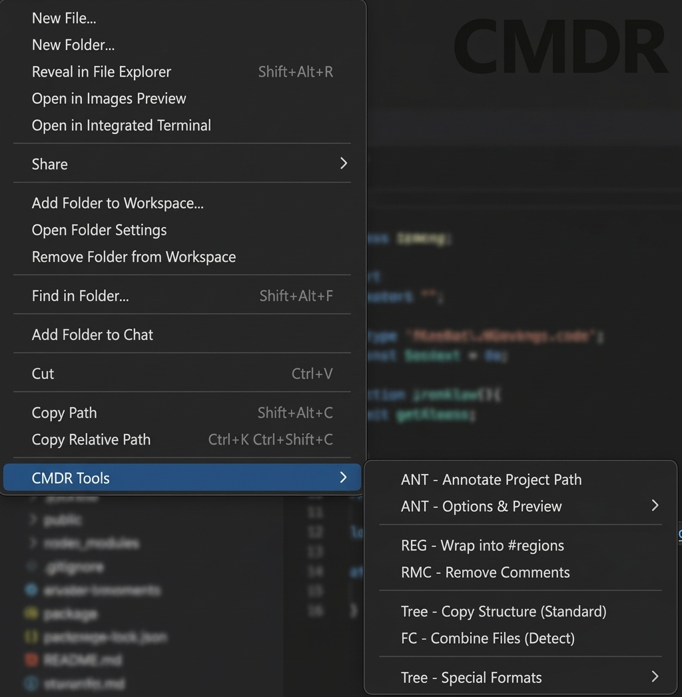

# CMDR Tools

CMDR Tools integrates the CMDR command-line toolkit into Visual Studio Code. It provides Explorer context-menu actions, Command Palette commands, CLI status and source management, managed installation/update controls, and a settings Webview.

<p align="center">
  
</p>

## Features

### File and project operations
- **Annotate files or directories** with standard, verbose, and dry-run modes.
- **Add `#region` wrappers** to code.
- **Remove comments** from selected files or directories.
- **Copy project tree structures** as standard, ASCII, JSON, CSV, or Markdown.
- **Combine files** through the CMDR `fc` command.
- **Generate passwords** for JSON files with default or custom lengths.

### CMDR CLI management
- Check the resolved CLI status and executable version.
- Check for stable CMDR CLI updates.
- Select System PATH, a custom executable, or the managed CMDR installation.
- Open managed installation and update controls in a dedicated settings view.
- Configure automatic managed updates and periodic version checks.

## Access

Commands are available from:
- The Explorer context menu under **CMDR Tools** (as shown above).
- The Command Palette (using the `CMDR:` category prefix). *Password commands are available here even though they are not in the Explorer context menu.*

## Installation

Install CMDR Tools from the VS Code Marketplace, or install a generated VSIX package:

```powershell
code --install-extension cli-helper-<version>.vsix
```

## CLI Configuration

Open the Command Palette and run:

```text
CMDR: CLI Settings
```

The settings view lets you select the CLI source and configure managed update behavior. You can also run `CMDR: Configure CLI Source` to select the source quickly.

For PATH or custom installations, install and update CMDR independently through the corresponding CMDR CLI distribution mechanism.

## Development and releases

For local builds, preparing a new version, and publishing a GitHub Release, follow the workflow described in the [build and release documentation](docs/release-local.md).

- `make build` builds a local VSIX package.
- `make release` creates and pushes a `vX.Y.Z` tag after changes are committed and the working tree is clean.
- GitHub Actions builds the VSIX and attaches it to the GitHub Release; you can download the package from the [Releases page](https://github.com/ZeroDayZ7/cli-helper-cmdr-extension-vscode/releases).

## Links

- [CMDR CLI repository](https://github.com/ZeroDayZ7/cmdr)
- [CMDR Tools extension repository](https://github.com/ZeroDayZ7/cli-helper-cmdr-extension-vscode)
